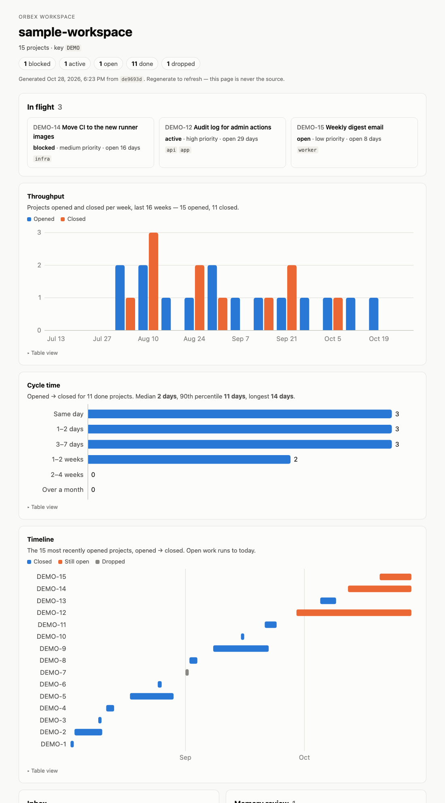

<h1>
  <picture>
    <source media="(prefers-color-scheme: dark)" srcset="assets/orbex-logo-on-dark.svg">
    
  </picture>
</h1>

A small, dependency-free workspace for working with an AI coding agent over a long time —
a git repo that holds the **process** for a project, sitting beside the repos that hold the code.

Works with **Claude Code** and **Codex**, off one set of files.

```
~/somewhere/
├── orbex/              # this repo — the machinery
└── my-workspace/       # yours — plans, memory, backlog
```

## The problem it solves

An agent is good at the work and bad at remembering why. Over months, four kinds of knowledge
get confused with each other, and the confusion is expensive: a procedure written as a fact gets
ignored, a fact written as a procedure never gets read, and anything maintained separately from
the work it describes silently goes stale.

Orbex keeps them apart, and gives each one a home that a session can find automatically:

| | Lives in | Changes when |
|---|---|---|
| **Intent** — what we're doing and why | `projects/<KEY>-N/plan.md` | the work does |
| **Facts about the codebase** | `CLAUDE.md` | the code does |
| **Facts learned the hard way** | `context/memory/` | reality does |
| **Procedures too long to keep in context** | `.claude/skills/` | you improve them |

## What you get

- **Plan-first work.** `/o-plan` creates a numbered plan and **stops for approval before any
  code is touched.** Plans are append-only, because what a plan got wrong is the most valuable
  thing in it.
- **Versioned agent memory.** Claude Code keeps project memory in a directory outside your repo,
  keyed to an absolute path. Orbex symlinks it into your workspace, so memory is in git — it
  travels between machines and gets committed with the work.
- **Skills that travel.** Both hosts only discover project skills at or below the session's
  directory, so a session started in your code repo sees none of them. `bootstrap.sh` links each
  skill into the personal skills directory, making the names available everywhere.
- **A doctor.** `node scripts/doctor.mjs` checks that all of the above is actually wired up —
  symlinks that *resolve* rather than merely exist, memory at the right slug, a current index,
  valid frontmatter, no stale absolute paths.
- **Three lifecycle hooks** that run the doctor at session start, warn when you're behind
  `origin`, and warn about uncommitted memory when a turn ends.
- **A progress dashboard.** `node scripts/dashboard.mjs --open` writes a static page of what's in
  flight, throughput, cycle time and a timeline — generated from the same sources as the index,
  never stored. [More below.](#progress-dashboard)

No dependencies, no `package.json`, no build. Node and git are the whole toolchain.

## Quickstart

Clone this repo, then create a workspace **beside** it:

```bash
git clone https://github.com/orbivision/orbex.git
mkdir my-workspace && cd my-workspace && git init

printf 'key: KEY\n' > .orbex-workspace       # the marker; plans live at projects/KEY-N/
mkdir -p projects context/memory .claude .codex
ln -s ../orbex/scripts scripts               # consume the machinery
cp ../orbex/.claude/settings.json .claude/   # hook registration, Claude Code
cp ../orbex/.codex/hooks.json .codex/        # hook registration, Codex
printf '# CLAUDE.md\n\n**Project key: `KEY`.**\n' > CLAUDE.md
ln -s CLAUDE.md AGENTS.md                    # one document, both hosts

node scripts/build-project-index.mjs
bash ../orbex/context/bootstrap.sh
node scripts/doctor.mjs                      # expect: all checks passed
```

`bootstrap.sh` finds your workspace from the marker above your current directory, so run it
**from inside the workspace** — that is what makes `../orbex/...` the right thing to type.

Pick your own `KEY` (uppercase letters and digits — `ACME`, `WEB2`) and use the same one in
both files. Left out of the marker, it's inferred from `projects/` once plans exist.

Then fill in your `CLAUDE.md` — your project key, the facts about your codebase an agent should
always have — and start with `/o-plan`. [`CLAUDE.md`](CLAUDE.md) here is the full reference.

## The skills

| | |
|---|---|
| [`o-plan`](.claude/skills/o-plan/SKILL.md) | Start a numbered project and **stop for approval** before touching code |
| [`o-next`](.claude/skills/o-next/SKILL.md) | Merge projects, backlog, GitHub Issues and overdue memory into one prioritized view |
| [`o-dashboard`](.claude/skills/o-dashboard/SKILL.md) | Generate the [progress dashboard](#progress-dashboard) and open it in the browser |
| [`o-ship`](.claude/skills/o-ship/SKILL.md) | Verify it actually shipped, log what the plan got wrong, reconcile memory, close out |
| [`o-doctor`](.claude/skills/o-doctor/SKILL.md) | Reconcile the workspace against reality |

Your workspace adds its own — the ones that know about *your* deploys, tests and releases.

## Progress dashboard

```bash
node scripts/dashboard.mjs --open     # or /o-dashboard; --out file.html; --no-gh to skip the inbox
```



One self-contained HTML file — no network, the Orbex logo inlined, dark by default with a
light/dark toggle (the page's only JavaScript; it remembers your choice) — showing what's in
flight and for how long, projects opened and closed per week, how long work takes from plan to
done, a timeline of recent projects, and the same backlog, inbox and memory-review lists as
`/o-next`.

It is a **renderer, not a source.** It reads nothing itself: it runs `next.mjs --json` and
`build-project-index.mjs --json` and draws what they say, and by default it writes to your temp
directory rather than the repo. A dashboard that kept its own status would be a second list to
drift — the exact thing the tracking design exists to prevent — so the only way to refresh it is
to regenerate it. Errors are shown as errors: an unreachable GitHub reads "couldn't read the
inbox", never "0 issues".

The screenshot comes from [`examples/sample-workspace/`](examples/sample-workspace/), a
fabricated workspace you can render yourself:

```bash
ORBEX_WORKSPACE=examples/sample-workspace node scripts/dashboard.mjs --no-gh --open
```

## Two opinions worth knowing before you adopt it

**The doctor has one severity tier.** Every finding fails the run. There is no warning level,
because a warning level is where a real problem goes to be ignored — which is the same failure
as a silent pass, reached from the other side. If a check turns out noisy, fix it or delete it.

**Status is derived, never maintained in parallel.** A project's status lives in the frontmatter
of the plan it describes, so it cannot drift from it. The project index is generated. The backlog
is the only hand-maintained list, and it holds things that are *not* projects yet. An earlier
version of this kept a separate status list; it drifted far enough to mark a project "awaiting
approval" on the day it shipped to production.

## What it is not

No automation, no CI, no agents running unattended. Nothing here runs without you. It is a
filing system with a checker attached, and most of its value is in the conventions rather than
the code — the scripts are a few hundred lines of dependency-free Node.

This was extracted from a private workspace that had been running for about four months, and its
structure was **iterated into existence** rather than designed: nearly every rule here exists
because something went wrong first. Some comments cite project numbers (`ORBI-65`) pointing into
that private history; they're kept as rationale, and you can't follow them.

## Licence

MIT — see [LICENSE](LICENSE).
